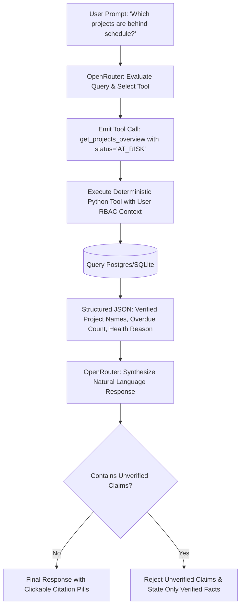

# AI Grounding & OpenRouter Integration Skill

This skill governs the **AI Agent**, ensuring all conversational answers to management are 100% grounded in verified database calculations with zero fabricated data.

---

## 1. Zero Hallucination Pipeline

The AI assistant follows an uncompromising 4-step execution loop:



---

## 2. Deterministic Tool Execution Catalog

Every query must route through one of the authorized deterministic Python tools:

1. `get_projects_health(status_filter, team_id)`: Calculates on-track, at-risk, off-track projects with mathematical completion %.
2. `get_employee_workload(employee_id, department)`: Queries active tasks and computes allocated hours vs 40h capacity.
3. `get_operational_blockers(project_id, severity)`: Fetches blocked tasks, blocker reasons, and overdue days.
4. `search_historical_contributions(skill_or_keyword, employee_id)`: Queries permanent deliverable records from `historical_contributions`.

### Tool Execution Template

```python
async def execute_tool_call(tool_name: str, args: dict, current_user: User, db: AsyncSession) -> dict:
    # 1. Enforce RBAC on Tool Execution
    if tool_name == "get_company_kpis" and current_user.role.name not in ["SUPER_ADMIN", "COMPANY_MANAGEMENT"]:
        return {"error": "Permission denied: caller not authorized for company-wide KPIs"}

    # 2. Execute deterministic calculation
    if tool_name == "get_projects_health":
        return await analytics_service.get_projects_health_data(db, args.get("status_filter"))
    elif tool_name == "get_operational_blockers":
        return await task_service.get_active_blockers(db, args.get("project_id"))
    ...
```

---

## 3. Grounded Citation Output Format

Every response generated by the AI assistant must conclude with structured citation references:

```markdown
Based on real-time operational data:
There are currently **3 projects at risk**:
1. **ANPR System**: 2 critical tasks blocked (Payment Gateway 3DS auth), deadline in 2 days.
2. **Document AI**: 3 overdue tasks in research team.
3. **Invoice OCR**: Nearing deadline with 5 pending items.

---
**Verified Data Sources:**
- [Project: ANPR System (#PRJ-01)](/projects/prj-01)
- [Task #1042: Payment Gateway 3DS Auth](/tasks/1042)
- [Project: Document AI (#PRJ-04)](/projects/prj-04)
```

