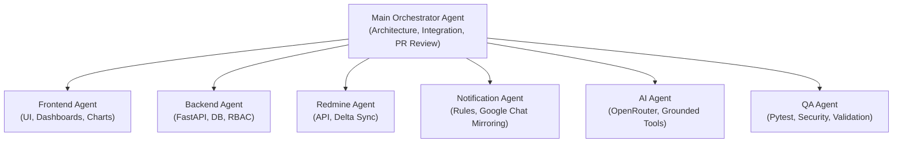

# Company Intelligence Platform Workflow Skill

This skill governs the sequential execution of development phases, ensuring that each specialized agent satisfies its quality gates before the Main Orchestrator allows progression.

---

## 1. Multi-Agent Organization & Ownership

---

## 2. Phased Progression & Quality Gates

### Phase 1: Foundation, Database & Core RBAC
- **Owners**: Backend Agent & Frontend Agent
- **Key Deliverables**:
  - `backend/`: FastAPI app, SQLAlchemy models, Alembic migrations, JWT Auth (`/login`, `/me`), RBAC dependencies.
  - `frontend/`: Next.js 14 App Router, Tailwind CSS, App Shell, Login page, Auth context.
- **Verification Gate**:
  - Super Admin can log in, receive a valid JWT token, and access protected routes.
  - An unauthorized user receives HTTP 401/403.

### Phase 2: Redmine Integration & Sync Engine
- **Owners**: Redmine Agent & Backend Agent
- **Key Deliverables**:
  - `backend/app/services/redmine_service.py`: Discovery, watermark delta sync loop, error backoff.
  - `backend/app/models/redmine_sync.py`: Mapping tables and sync logs.
- **Verification Gate**:
  - Test sync imports Redmine projects, tasks, and users without duplicates.
  - Sync state is tracked and logged in `redmine_sync_state`.

### Phase 3: Core Role-Based Dashboards
- **Owners**: Frontend Agent & Backend Agent
- **Key Deliverables**:
  - Company Dashboard: Executive KPIs, project health donuts, delivery velocity.
  - Project Dashboard: Milestones, contributors, task burn-down, health explanation.
  - Team Dashboard: Headcount, member workloads, capacity utilization.
  - Employee 360 Dashboard: Current tasks, historical contributions, verified skills.
- **Verification Gate**:
  - Drill-down navigation works seamlessly from Company -> Project -> Team -> Employee.
  - Role-based visibility is respected.

### Phase 4: Notification Engine & Google Chat Integration
- **Owners**: Notification Agent & QA Agent
- **Key Deliverables**:
  - In-app notification bar (bell counter, drawer).
  - Configurable alert rules (overdue tasks, blocked tasks, workload overload).
  - **Admin Google Chat Mirroring**: 100% of notifications received in the notification bar are automatically mirrored to Admin Google Chat via Cards v2 webhooks.
- **Verification Gate**:
  - An overdue task generates an in-app notification and simultaneously delivers an actionable Google Chat card to the Admin space.

### Phase 5: Grounded AI Assistant (OpenRouter)
- **Owners**: AI Agent & Backend Agent
- **Key Deliverables**:
  - OpenRouter API integration.
  - Deterministic tool registry (zero hallucination).
  - Slide-out AI assistant drawer with source citations.
- **Verification Gate**:
  - Query *"Which projects are at risk?"* executes backend metric tool, returns real data, and includes clickable source chips.

### Phase 6: Reports, Analytics & Employee Growth
- **Owners**: Backend Agent & Frontend Agent
- **Key Deliverables**:
  - Executive reports generator and CSV exports.
  - Employee growth & skill matrix tracking.

### Phase 7: Hardening, QA & Deployment
- **Owners**: QA Agent & Main Orchestrator Agent
- **Key Deliverables**:
  - Automated test suites (Pytest + Vitest).
  - Zero security leaks (token inspection, RBAC boundary penetration).
  - Docker Compose configuration and production setup guide.

