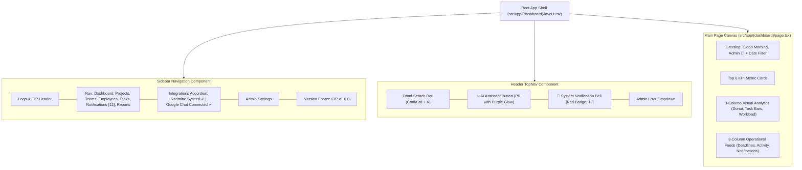

# Frontend Dashboard & UI Architecture Skill

This skill provides implementation patterns, design tokens, and component guidelines for the **Frontend Agent** building the Next.js 14 App Router client.

---

## 1. Design System & Theme Specifications

The platform UI reflects a modern, polished enterprise standard matching the reference architecture:

### 1.1 Color Tokens & Palette
- **Sidebar Background**: Deep Dark Indigo / Midnight (`#0F172A` / `#1E1B4B`)
- **Active Navigation Item**: Vibrant Purple Indigo (`#6366F1` with white text and rounded-lg padding)
- **Main Canvas Background**: Off-white / Soft Slate (`#F8FAFC`)
- **Card Background**: Pure White (`#FFFFFF`) with subtle border (`border border-slate-200/80 rounded-2xl shadow-sm`)
- **Metric Cards Accents**:
  - Purple Folder: Active Projects (`#8B5CF6`)
  - Blue Check: Open Tasks (`#3B82F6`)
  - Amber/Red Triangle: Projects at Risk (`#EF4444`)
  - Violet Team: Total Employees (`#6366F1`)
  - Green Badge: Task Completion % (`#10B981`)
- **Severity Badge Colors**:
  - `Critical`: Pink-red pill (`bg-red-50 text-red-700 border-red-200`)
  - `Warning`: Amber pill (`bg-amber-50 text-amber-700 border-amber-200`)
  - `Upcoming`: Indigo pill (`bg-indigo-50 text-indigo-700 border-indigo-200`)

---

## 2. Shell Layout Architecture

---

## 3. Recharts Visualizations Specifications

### 3.1 Project Status Overview (Donut Chart)
- **Type**: `PieChart` with `innerRadius={65}` and `outerRadius={90}`.
- **Center Text**: Total active projects count (`18 Projects`).
- **Legend & Breakdown**:
  - Green (`#10B981`): On Track (11, 61%)
  - Amber (`#F59E0B`): At Risk (3, 17%)
  - Blue (`#3B82F6`): In Progress (2, 11%)
  - Purple (`#8B5CF6`): Completed (2, 11%)

### 3.2 Task Distribution (Vertical Bar Chart)
- **Type**: `BarChart` with rounded top corners (`radius={[6, 6, 0, 0]}`).
- **Columns**:
  - In Progress (`#8B5CF6`, 64)
  - Pending (`#3B82F6`, 42)
  - Overdue (`#EF4444`, 18)
  - Blocked (`#F59E0B`, 12)
  - Completed (`#10B981`, 76)

### 3.3 Team Workload (Horizontal Stacked Bar Chart)
- **Type**: `BarChart` with `layout="vertical"`.
- **Stacks**: `stackId="a"` for Completed (Green), In Progress (Blue), Overdue (Red).
- **Categories**: AI Team, Development, QA Team, Research, Operations.

---

## 4. Frontend State & Data Fetching Patterns

1. **Server State Caching**: Use `@tanstack/react-query` with a 30-second stale time for dashboard KPIs.
2. **Real-Time Notification Bar**: Connect via `EventSource` to `/api/v1/notifications/stream`. On incoming SSE event, automatically increment bell badge count and prepend notification to drawer list.
3. **No Non-Functional Controls**: Every "View All →" link routes to its corresponding subpage (`/projects`, `/tasks`, `/notifications`).

