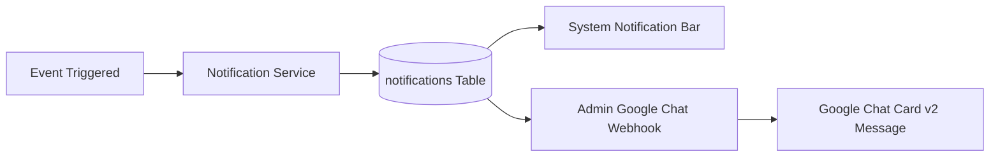

# Notification Engine & Admin Google Chat Mirroring Skill

This skill defines the procedures, schemas, and verification rules for the notification system, specifically governing real-time dual dispatch between the **System Notification Bar** and **Admin Google Chat Webhooks**.

---

## 1. Architectural Mandate: Admin Google Chat Mirroring

Whenever an operational event triggers an in-app notification for any user (or company-wide):
1. The notification is persisted in the `notifications` database table.
2. The notification is pushed in real-time to the **System Notification Bar** (in-app header bell, drawer, and badge counter) via Server-Sent Events (SSE) or WebSockets.
3. **Simultaneously and without exception**, the notification dispatcher creates a mirrored task that formats the exact same payload into a **Google Chat Card v2** message and sends it via HTTPS POST to the Administrator's configured Google Chat webhook space (`ADMIN_SYSTEM_MIRROR`).



---

## 2. Notification Severity Matrix

| Severity | Color Code | Notification Bar Style | Admin Google Chat Tag |
|---|---|---|---|
| `INFO` | `#3B82F6` (Blue) | Standard bell list item | `[SYSTEM NOTIFICATION] INFO` |
| `WARNING` | `#F59E0B` (Amber) | Amber unread dot + toast | `[SYSTEM NOTIFICATION] WARNING` |
| `URGENT` | `#F97316` (Orange) | Orange badge + persistent banner | `[SYSTEM NOTIFICATION] URGENT` |
| `CRITICAL` | `#EF4444` (Red) | High-priority modal / alert banner | `[SYSTEM NOTIFICATION] CRITICAL` |

---

## 3. Google Chat Card v2 Standard Formatter

When constructing the payload for the Administrator's Google Chat webhook, always adhere to the following template:

```python
def format_admin_mirrored_card(notification: dict, app_base_url: str) -> dict:
    """Formats an in-app system notification into an actionable Google Chat Card v2 for Admin."""
    severity = notification.get("severity", "INFO")
    title = notification.get("title", "Operational Update")
    message = notification.get("message", "")
    entity_type = notification.get("entity_type", "SYSTEM")
    entity_id = notification.get("entity_id", "")
    created_at = notification.get("created_at", "")

    # Icons per severity
    icon_map = {
        "INFO": "https://img.icons8.com/color/48/info--v1.png",
        "WARNING": "https://img.icons8.com/color/48/warning-shield.png",
        "URGENT": "https://img.icons8.com/color/48/alarm.png",
        "CRITICAL": "https://img.icons8.com/color/48/error--v1.png"
    }

    deep_link = f"{app_base_url}/notifications"
    if entity_type == "TASK" and entity_id:
        deep_link = f"{app_base_url}/tasks/{entity_id}"
    elif entity_type == "PROJECT" and entity_id:
        deep_link = f"{app_base_url}/projects/{entity_id}"

    return {
        "cardsV2": [
            {
                "cardId": f"admin-notif-{notification.get('id')}",
                "card": {
                    "header": {
                        "title": f"[SYSTEM BAR MIRROR] {severity}: {title}",
                        "subtitle": f"Category: {entity_type} | Time: {created_at}",
                        "imageUrl": icon_map.get(severity, icon_map["INFO"]),
                        "imageType": "CIRCLE"
                    },
                    "sections": [
                        {
                            "widgets": [
                                {
                                    "decoratedText": {
                                        "topLabel": "Notification Content",
                                        "text": f"<b>{message}</b>",
                                        "wrapText": True
                                    }
                                },
                                {
                                    "buttonList": {
                                        "buttons": [
                                            {
                                                "text": "Open in Platform",
                                                "onClick": {
                                                    "openLink": {
                                                        "url": deep_link
                                                    }
                                                }
                                            }
                                        ]
                                    }
                                }
                            ]
                        }
                    ]
                }
            }
        ]
    }
```

---

## 4. Verification & Testing Checklist

When implementing or testing this feature:
1. **Trigger Test Notification**: Call `POST /api/v1/notifications/test-trigger` with `{ "severity": "WARNING", "title": "Test Alert", "message": "Verification test" }`.
2. **Verify Notification Bar**: Check that the frontend notification bell counter increments and the notification appears in the header drawer.
3. **Verify Admin Google Chat Delivery**: Inspect `notification_deliveries` database table and verify HTTP 200 response from Google Chat webhook.
4. **Retry Handling**: Disconnect webhook URL and verify that 3 retries are logged before status is marked as `FAILED`.

