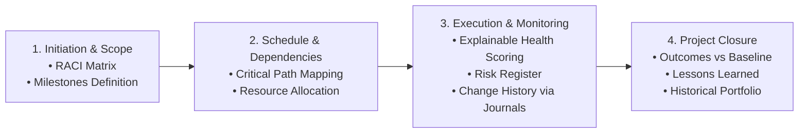

# Project Management & Delivery Governance Skill

This skill governs end-to-end project lifecycle management, combining **Asana project management methodology** with **VoltAgent Project Manager subagent practices** tailored to the Company Intelligence Platform.

---

## 1. Core Responsibilities & Methodology

### Key Principles
1. **Explainable Health Status**: Never present a project as `AT_RISK` without a deterministic justification (e.g. *"2 critical path tasks overdue by 4 days, impacting Milestone 2"*).
2. **Configurable Performance Standards**: Targets like on-time delivery thresholds and budget variance allowances must be configurable at the organization level, never hardcoded.
3. **Operational vs. Management Intelligence Separation**:
   - **Operational facts** (milestone dates, logged hours, blocker counts) are calculated deterministically.
   - **Management insights** (impact explanations, executive summaries, mitigation advice) are synthesized by the AI layer grounded in those facts.

---

## 2. Risk Register & Mitigation Architecture

Every active project maintains an active **Risk Register** (`project_risks` table):

| Risk Attribute | Description | Example Values |
|---|---|---|
| **Risk Category** | Technical, Resource, External Dependency, Scope | `EXTERNAL_DEPENDENCY` |
| **Probability** | Likelihood of occurrence | `LOW`, `MEDIUM`, `HIGH` |
| **Impact** | Severity of delivery consequence | `MINOR`, `MODERATE`, `CRITICAL` |
| **Risk Score** | Calculated score: $P \times I$ | Numeric 1 to 9 |
| **Mitigation Plan** | Actionable proactive measures | *"Obtain fallback sandbox keys from vendor"* |
| **Contingency Plan** | Reactive steps if risk materializes | *"Temporarily mock 3DS response for QA"* |
| **Owner** | Designated responsible engineer/lead | Assigned Employee ID |

---

## 3. RACI Responsibility Assignment Matrix

Each project and major deliverable tracks clear role accountability:

- **Responsible (R)**: The individual(s) who complete the task or deliverable.
- **Accountable (A)**: The single individual with decision-making authority and ultimate accountability.
- **Consulted (C)**: Domain experts or stakeholders providing two-way feedback before decisions.
- **Informed (I)**: Stakeholders kept updated on progress (e.g., automatically notified via Google Chat).

---

## 4. Milestone & Dependency Management

### 4.1 Milestone Delivery Gates
- Synced from Redmine Versions (`versions.json`) or created internally.
- Statuses: `OPEN`, `LOCKED`, `CLOSED`.
- Metrics: Total tasks, closed tasks, target release date, and critical path slip.

### 4.2 Critical Path & Blocker Blast Radius
When a task is flagged as blocked (`is_blocked = True`), the Project Manager agent computes:
$$\text{Blocked Chain} = \text{Successor Tasks}(\text{Task ID})$$
If any successor task belongs to an upcoming Milestone due within $\le 5$ days, the Project Health is immediately set to `AT_RISK` and an urgent escalation is dispatched.

---

## 5. Project Change History & Audit Tracking

Project plans change for real operational reasons (scope revisions, technical pivots, personnel reallocations).
- Track every change to `target_completion_date`, `estimated_total_hours`, or milestone dates in `task_journals`.
- Captures: `changed_by`, `previous_value`, `new_value`, and `justification_reason`.

---

## 6. Project Closure & Lessons Learned

Upon project completion (`status = 'COMPLETED'`):
1. **Closure Audit**: Compares baseline estimate vs actual hours spent.
2. **Lessons Learned Capture**: Documents what went well, delivery bottlenecks, and technical debt.
3. **Historical Portfolio Ingestion**: Automatically aggregates each participant's contributions into `historical_contributions` so their permanent achievements are never lost.

