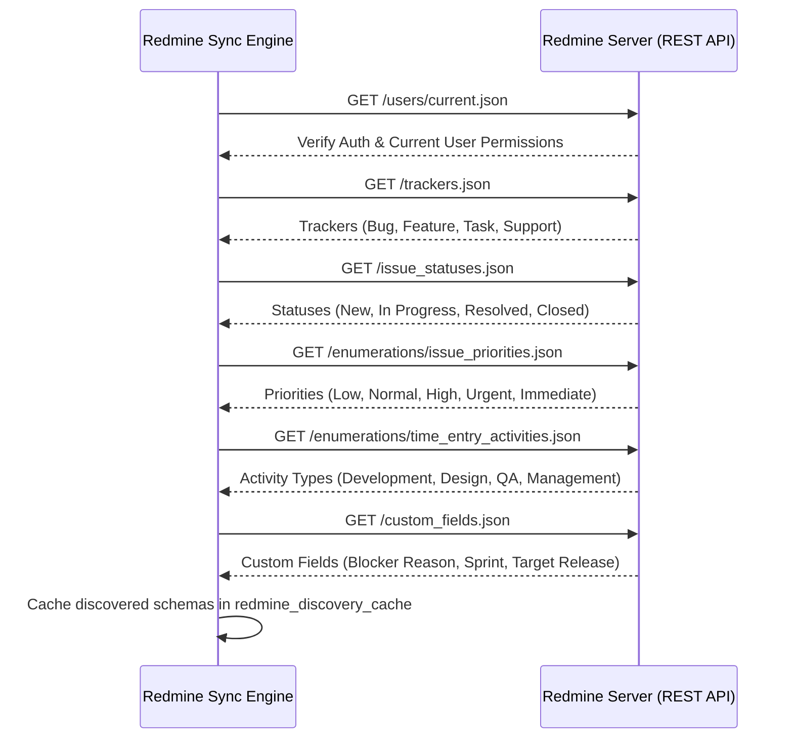

# Redmine Integration & Delta Synchronization Skill

This skill provides step-by-step procedures, data mapping rules, operational safety standards, and error-handling protocols for the Redmine synchronization engine.

---

## 1. Discovery Handshake & Schema Inspection (MCP Market Reference)

Before initiating data synchronization, execute the structured discovery handshake to inspect the target Redmine environment:



---

## 2. Comprehensive Entity Mapping Matrix (Redmine CLI Reference)

| Redmine Entity | Platform Model | Key Mappings & Logic |
|---|---|---|
| **Projects** (`/projects.json`) | `projects` | `name`, `identifier` -> `code`, `description`, `status` (1: ACTIVE, 5: COMPLETED, 9: ON_HOLD). |
| **Versions / Milestones** (`/projects/{id}/versions.json`) | `project_milestones` | Milestone name, description, due date, status (`open`, `locked`, `closed`), sharing scope. |
| **Issues & Subtasks** (`/issues.json`) | `tasks` | Subject, tracker, status, priority, estimated/spent hours, `parent_id` (subtask hierarchy), `done_ratio`. |
| **Journals / Change History** (`include=journals`) | `task_journals` | Captures historical audit trail: status changes, reassigned developers, deadline slips, and comments. |
| **Memberships** (`/projects/{id}/memberships.json`) | `project_members` | Maps external users and assigned roles (Developer, Manager, Reporter) to internal contributors. |
| **Time Entries** (`/time_entries.json`) | `time_entries` | Hours logged, spent date, activity category, user link, and issue link. |
| **Custom Fields** | `tasks.custom_attributes` | Safely parses custom fields (e.g. "Blocker Reason", "PR URL") into structured JSONB. |

---

## 3. Watermark Delta Synchronization Procedure

To avoid server overhead, follow the incremental polling watermark strategy:

```python
async def run_incremental_sync(db_session, redmine_client):
    # 1. Fetch last sync watermark
    state = await get_sync_state(db_session, entity_type="ISSUES")
    watermark = state.last_sync_timestamp # ISO timestamp

    # 2. Fetch modified issues since watermark (with pagination safety)
    offset = 0
    limit = 100
    while True:
        issues = await redmine_client.get_issues(
            updated_on=f">={watermark.isoformat()}",
            offset=offset,
            limit=limit,
            include=["journals"]  # Fetch change history
        )
        if not issues:
            break

        # 3. Upsert into platform tasks and task_journals
        for issue in issues:
            task_uuid = await upsert_task_from_redmine(db_session, issue)
            await record_mapping(db_session, "ISSUE", issue.id, task_uuid)
            if hasattr(issue, "journals"):
                await sync_task_journals(db_session, task_uuid, issue.journals)

        offset += limit
        if len(issues) < limit:
            break

    # 4. Update watermark to current execution start time
    await update_sync_watermark(db_session, "ISSUES", datetime.utcnow())
```

---

## 4. Operational Safety Standards (Redmine CLI Invariants)

1. **Discover Before Querying**: Never hardcode custom field IDs or tracker IDs. Always resolve them dynamically via discovery cache.
2. **Handle Pagination Strictly**: Never fetch unbounded lists without `limit` and `offset`. Always cap page size to $\le 100$.
3. **Inspect Journals for Root Cause**: When a project deadline slips or a task is re-opened, inspect the issue journals to extract explainable reasons for management dashboards.
4. **Avoid Blind Retries**: If Redmine returns HTTP 401/403 (auth error) or 422 (validation error), abort immediately and log an administrative alert. Only retry transient HTTP 429 (rate limit) or 503 (service unavailable) with exponential backoff.
5. **Read-Only Invariant**: Redmine is an external system of record. Do not modify tickets, statuses, or time entries unless explicitly triggered by an authorized user through a confirmed action.
6. **Graceful Offline Degradation**: When Redmine is unreachable, the platform must serve the latest synced database snapshot, displaying a clear notice: *"Displaying synchronized snapshot from [timestamp]"*.
