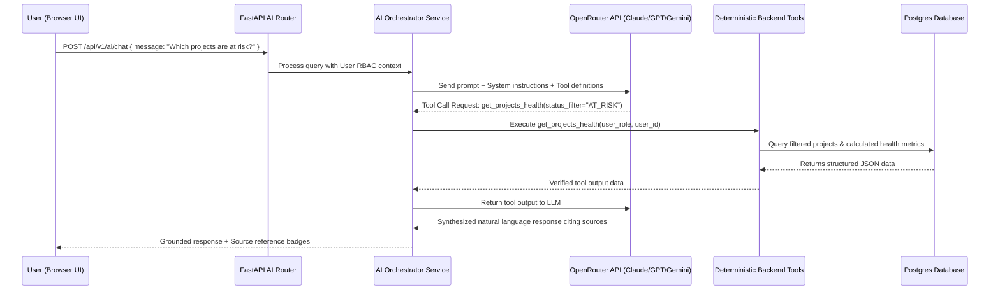

# AI AGENT ARCHITECTURE & GROUNDED RETRIEVAL SPECIFICATION
## AI Agent: OpenRouter Integration, Deterministic Tools & Grounded Responses

---

## 1. Overview & Core Principles

The **AI Agent** provides conversational intelligence to management and teams, enabling natural language questions such as:
- *"Which projects are currently at risk and why?"*
- *"Who worked on the authentication module in the mobile project last quarter?"*
- *"Show me employees who have experience in React and Docker with available capacity next week."*
- *"Summarize the blockers across all mobile teams today."*

### Core Architectural Principles
1. **Grounded In Reality (Zero Hallucination)**: The AI does not guess metrics or fabricate employee records. Every numerical calculation (e.g. overdue tasks count, project completion percentage) is calculated by deterministic backend Python functions.
2. **Strict RBAC Context Filtering**: The AI assistant runs under the active user's authorization. An employee asking about private team salaries or company-wide confidential notes will be refused by the permission gate.
3. **Traceability & Citations**: Responses must cite exact source entities (e.g. `[Project: Alpha Core #PRJ-01]`, `[Task #1042: Payment Gateway]`).
4. **No Direct Database Mutation**: The AI Agent is read-only. It cannot execute `INSERT`, `UPDATE`, or `DELETE` statements or alter Redmine data.

---

## 2. Agent Interaction & Execution Pipeline



---

## 3. Deterministic Backend Tool Catalog

The AI Assistant is provided with a curated suite of executable Python tool signatures:

### 3.1 Tool Definitions

```python
# 1. Get Project Health & Metrics
def get_projects_overview(
    status: Optional[str] = None, # "ACTIVE", "AT_RISK", "ALL"
    team_id: Optional[str] = None
) -> dict:
    """Returns projects list with completion %, deadline, health status, and explainable health reason."""
    ...

# 2. Get Employee 360 & Workload
def get_employee_workload(
    employee_id: Optional[str] = None,
    department: Optional[str] = None
) -> dict:
    """Returns assigned active tasks, weekly hours allocated vs capacity, and workload overload flags."""
    ...

# 3. Search Historical Contributions
def search_historical_contributions(
    query_skill_or_keyword: str,
    project_id: Optional[str] = None
) -> list[dict]:
    """Searches past employee deliverables, completed milestones, and skills demonstrated."""
    ...

# 4. Get Active Blockers & Overdue Work
def get_operational_blockers(
    project_id: Optional[str] = None,
    severity: Optional[str] = None
) -> list[dict]:
    """Returns overdue tasks, blocked tasks with reasons, and assignee information."""
    ...

# 5. Team Velocity & Milestone Progress
def get_team_performance_summary(
    team_id: str,
    time_window_days: int = 30
) -> dict:
    """Returns tasks completed, velocity trends, and time entries summary."""
    ...
```

---

## 4. OpenRouter Gateway Configuration

The backend connects to OpenRouter via standard OpenAI-compatible REST endpoints.

### 4.1 Configuration Settings
```env
OPENROUTER_API_KEY=sk-or-v1-xxxxxxxxxxxxxxxxxxxx
OPENROUTER_BASE_URL=https://openrouter.ai/api/v1
OPENROUTER_DEFAULT_MODEL=anthropic/claude-3.5-sonnet
OPENROUTER_FALLBACK_MODEL=google/gemini-2.0-flash-001
OPENROUTER_APP_NAME=Company Intelligence Platform
```

### 4.2 Multi-Model Fallback Strategy
If the primary model (`anthropic/claude-3.5-sonnet`) experiences high latency (>10s) or rate limiting, the AI service automatically falls back to `google/gemini-2.0-flash-001` or `openai/gpt-4o-mini` without interrupting user experience.

---

## 5. UI Presentation of Grounded Intelligence

In the Next.js frontend, AI responses are presented in an expandable slide-out intelligence drawer:
- **Conversation History**: Stored per user.
- **Source Citation Chips**: Clickable pills below the response (e.g. `[Project: Core E-commerce #PRJ-01]` that link directly to `/projects/prj-01`).
- **Data Confidence Badge**: *"Grounded with 3 database records | Generated at 16:30"*
- **Audit Logging**: Every AI query, model name, tokens used, and tool calls are recorded in `ai_messages` for compliance and cost tracking.

