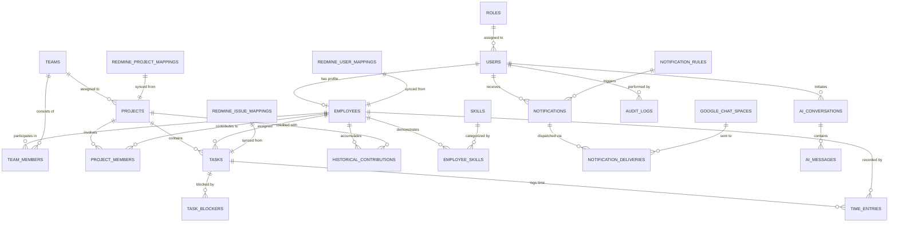

# DATABASE DESIGN & ENTITY RELATIONSHIPS
## Company Intelligence Platform: Data Architecture Specification

---

## 1. Relational Entity Relationship Diagram (ERD)

The database preserves all active operational structures as well as historical employee contributions, team associations, and task records even if assignments shift over time.

---

## 2. Table Schemas & Specifications

### 2.1 Identity, Authentication & Roles

#### `roles`
Stores standard system roles with permission bits or granular permissions.
- `id`: VARCHAR(36) PK (UUID)
- `name`: VARCHAR(50) UNIQUE NOT NULL (`SUPER_ADMIN`, `COMPANY_MANAGEMENT`, `PROJECT_MANAGER`, `TEAM_LEAD`, `EMPLOYEE`)
- `description`: TEXT
- `permissions`: JSONB NOT NULL DEFAULT `[]`
- `created_at`: TIMESTAMPTZ NOT NULL DEFAULT NOW()

#### `users`
Authentication credentials and account status.
- `id`: VARCHAR(36) PK (UUID)
- `email`: VARCHAR(255) UNIQUE NOT NULL (indexed)
- `hashed_password`: VARCHAR(255) NOT NULL
- `role_id`: VARCHAR(36) NOT NULL FK -> `roles.id`
- `is_active`: BOOLEAN NOT NULL DEFAULT TRUE
- `created_at`: TIMESTAMPTZ NOT NULL DEFAULT NOW()
- `updated_at`: TIMESTAMPTZ NOT NULL DEFAULT NOW()

---

### 2.2 Organization, Employees & Skills

#### `employees`
Detailed employee profile, title, department, contact info.
- `id`: VARCHAR(36) PK (UUID)
- `user_id`: VARCHAR(36) UNIQUE FK -> `users.id` (nullable for synced external users without login)
- `employee_number`: VARCHAR(50) UNIQUE (indexed)
- `first_name`: VARCHAR(100) NOT NULL
- `last_name`: VARCHAR(100) NOT NULL
- `email`: VARCHAR(255) UNIQUE NOT NULL (indexed)
- `job_title`: VARCHAR(150) NOT NULL
- `department`: VARCHAR(100) NOT NULL
- `manager_id`: VARCHAR(36) FK -> `employees.id` (nullable)
- `hire_date`: DATE NOT NULL
- `status`: VARCHAR(30) NOT NULL DEFAULT 'ACTIVE' (`ACTIVE`, `ON_LEAVE`, `DEPARTED`)
- `weekly_capacity_hours`: NUMERIC(4, 1) NOT NULL DEFAULT 40.0
- `google_chat_email`: VARCHAR(255) (for DM notifications)
- `avatar_url`: TEXT
- `created_at`: TIMESTAMPTZ NOT NULL DEFAULT NOW()
- `updated_at`: TIMESTAMPTZ NOT NULL DEFAULT NOW()

#### `teams`
Organizational or functional teams.
- `id`: VARCHAR(36) PK (UUID)
- `name`: VARCHAR(150) UNIQUE NOT NULL
- `description`: TEXT
- `lead_id`: VARCHAR(36) FK -> `employees.id` (team leader)
- `department`: VARCHAR(100)
- `is_active`: BOOLEAN NOT NULL DEFAULT TRUE
- `created_at`: TIMESTAMPTZ NOT NULL DEFAULT NOW()

#### `team_members`
Association between employees and teams (supports multiple teams & historical tenure).
- `id`: VARCHAR(36) PK (UUID)
- `team_id`: VARCHAR(36) NOT NULL FK -> `teams.id` ON DELETE CASCADE
- `employee_id`: VARCHAR(36) NOT NULL FK -> `employees.id` ON DELETE CASCADE
- `role_in_team`: VARCHAR(50) DEFAULT 'MEMBER' (`LEAD`, `CORE_MEMBER`, `CONTRIBUTOR`)
- `joined_at`: DATE NOT NULL
- `left_at`: DATE (nullable, if departed from team)
- `is_active`: BOOLEAN NOT NULL DEFAULT TRUE

#### `skills` & `employee_skills`
Tracks employee skills, verified competencies, and professional growth.
- `skills`: `id`, `name`, `category` (`FRONTEND`, `BACKEND`, `DEVOPS`, `MANAGEMENT`, `QA`)
- `employee_skills`: `id`, `employee_id` FK, `skill_id` FK, `proficiency_level` (`BEGINNER`, `INTERMEDIATE`, `ADVANCED`, `EXPERT`), `last_verified_at`, `notes`.

---

### 2.3 Projects, Tasks & Work Delivery

#### `company_goals` (Strategic OKRs)
Connects operational projects to overarching company objectives.
- `id`: VARCHAR(36) PK (UUID)
- `title`: VARCHAR(255) NOT NULL
- `quarter`: VARCHAR(10) NOT NULL (e.g. `2026-Q1`, `2026-Q2`)
- `target_metric`: VARCHAR(150) NOT NULL
- `current_progress`: NUMERIC(5, 2) DEFAULT 0.0
- `owner_id`: VARCHAR(36) FK -> `employees.id`
- `status`: VARCHAR(30) DEFAULT 'ACTIVE' (`ACTIVE`, `ACHIEVED`, `AT_RISK`)
- `created_at`: TIMESTAMPTZ NOT NULL DEFAULT NOW()

#### `projects`
Represents client or internal deliverables.
- `id`: VARCHAR(36) PK (UUID)
- `goal_id`: VARCHAR(36) FK -> `company_goals.id` (nullable, links project to strategic OKR)
- `name`: VARCHAR(200) NOT NULL
- `code`: VARCHAR(50) UNIQUE NOT NULL (indexed)
- `description`: TEXT
- `status`: VARCHAR(30) NOT NULL DEFAULT 'ACTIVE' (`PLANNING`, `ACTIVE`, `ON_HOLD`, `COMPLETED`, `CANCELLED`)
- `health_status`: VARCHAR(20) NOT NULL DEFAULT 'ON_TRACK' (`ON_TRACK`, `AT_RISK`, `OFF_TRACK`, `BLOCKED`)
- `health_reason`: TEXT (Explainable justification generated by metrics/rules)
- `project_manager_id`: VARCHAR(36) FK -> `employees.id`
- `primary_team_id`: VARCHAR(36) FK -> `teams.id`
- `start_date`: DATE
- `target_completion_date`: DATE
- `actual_completion_date`: DATE
- `estimated_total_hours`: NUMERIC(8, 2) DEFAULT 0.0
- `progress_percentage`: NUMERIC(5, 2) DEFAULT 0.0
- `created_at`: TIMESTAMPTZ NOT NULL DEFAULT NOW()
- `updated_at`: TIMESTAMPTZ NOT NULL DEFAULT NOW()

#### `project_members`
Tracks contributors assigned to a project.
- `id`: VARCHAR(36) PK (UUID)
- `project_id`: VARCHAR(36) NOT NULL FK -> `projects.id` ON DELETE CASCADE
- `employee_id`: VARCHAR(36) NOT NULL FK -> `employees.id` ON DELETE CASCADE
- `role_in_project`: VARCHAR(50) DEFAULT 'CONTRIBUTOR'
- `allocated_hours_per_week`: NUMERIC(4, 1) DEFAULT 0.0
- `joined_at`: DATE NOT NULL
- `left_at`: DATE

#### `tasks`
Work items synced from Redmine or created internally.
- `id`: VARCHAR(36) PK (UUID)
- `project_id`: VARCHAR(36) NOT NULL FK -> `projects.id` ON DELETE CASCADE (indexed)
- `assigned_to_id`: VARCHAR(36) FK -> `employees.id` (indexed)
- `author_id`: VARCHAR(36) FK -> `employees.id`
- `title`: VARCHAR(255) NOT NULL
- `description`: TEXT
- `tracker`: VARCHAR(50) NOT NULL DEFAULT 'Feature' (`Feature`, `Bug`, `Support`, `Task`)
- `status`: VARCHAR(50) NOT NULL DEFAULT 'New' (`New`, `In Progress`, `Feedback`, `Resolved`, `Closed`, `Rejected`)
- `priority`: VARCHAR(30) NOT NULL DEFAULT 'Normal' (`Low`, `Normal`, `High`, `Urgent`, `Immediate`)
- `estimated_hours`: NUMERIC(6, 2) DEFAULT 0.0
- `spent_hours`: NUMERIC(6, 2) DEFAULT 0.0
- `progress_percentage`: INT DEFAULT 0
- `cycle_time_hours`: NUMERIC(7, 2) DEFAULT NULL (duration from In Progress to Resolved)
- `start_date`: DATE
- `due_date`: DATE (indexed)
- `is_overdue`: BOOLEAN NOT NULL DEFAULT FALSE
- `is_blocked`: BOOLEAN NOT NULL DEFAULT FALSE
- `blocker_reason`: TEXT
- `created_at`: TIMESTAMPTZ NOT NULL DEFAULT NOW()
- `updated_at`: TIMESTAMPTZ NOT NULL DEFAULT NOW()

#### `task_dependencies`
Tracks predecessor/successor relationships for Critical Path & Blocker propagation analysis.
- `id`: VARCHAR(36) PK (UUID)
- `task_id`: VARCHAR(36) NOT NULL FK -> `tasks.id` ON DELETE CASCADE (the blocked task)
- `depends_on_task_id`: VARCHAR(36) NOT NULL FK -> `tasks.id` ON DELETE CASCADE (the blocker task)
- `dependency_type`: VARCHAR(30) DEFAULT 'BLOCKS' (`BLOCKS`, `RELATES_TO`, `PRECEDES`)

#### `time_entries`
Logged work hours against tasks and projects.
- `id`: VARCHAR(36) PK (UUID)
- `task_id`: VARCHAR(36) FK -> `tasks.id` ON DELETE SET NULL
- `project_id`: VARCHAR(36) NOT NULL FK -> `projects.id` ON DELETE CASCADE
- `employee_id`: VARCHAR(36) NOT NULL FK -> `employees.id` ON DELETE CASCADE (indexed)
- `spent_on`: DATE NOT NULL (indexed)
- `hours`: NUMERIC(5, 2) NOT NULL
- `activity_type`: VARCHAR(50) DEFAULT 'Development'
- `comments`: TEXT
- `created_at`: TIMESTAMPTZ NOT NULL DEFAULT NOW()

#### `project_milestones` (Versions)
Tracks major project release targets and sprint deliverables.
- `id`: VARCHAR(36) PK (UUID)
- `project_id`: VARCHAR(36) NOT NULL FK -> `projects.id` ON DELETE CASCADE
- `title`: VARCHAR(150) NOT NULL
- `description`: TEXT
- `status`: VARCHAR(30) DEFAULT 'OPEN' (`OPEN`, `LOCKED`, `CLOSED`)
- `due_date`: DATE (indexed)
- `sharing_scope`: VARCHAR(50) DEFAULT 'NONE'
- `created_at`: TIMESTAMPTZ NOT NULL DEFAULT NOW()

#### `project_risks` (Risk Register)
Proactively documents project risks, probability, consequences, and mitigations.
- `id`: VARCHAR(36) PK (UUID)
- `project_id`: VARCHAR(36) NOT NULL FK -> `projects.id` ON DELETE CASCADE
- `title`: VARCHAR(200) NOT NULL
- `category`: VARCHAR(50) NOT NULL (`TECHNICAL`, `RESOURCE`, `EXTERNAL_DEPENDENCY`, `SCOPE`)
- `probability`: VARCHAR(20) NOT NULL (`LOW`, `MEDIUM`, `HIGH`)
- `impact`: VARCHAR(20) NOT NULL (`MINOR`, `MODERATE`, `CRITICAL`)
- `risk_score`: INT NOT NULL (1 to 9)
- `mitigation_plan`: TEXT NOT NULL
- `contingency_plan`: TEXT
- `owner_id`: VARCHAR(36) FK -> `employees.id`
- `status`: VARCHAR(30) DEFAULT 'ACTIVE' (`ACTIVE`, `MITIGATED`, `OCCURRED`, `CLOSED`)
- `created_at`: TIMESTAMPTZ NOT NULL DEFAULT NOW()

#### `project_raci` (Responsibility Matrix)
Explicitly defines role accountability per project deliverable.
- `id`: VARCHAR(36) PK (UUID)
- `project_id`: VARCHAR(36) NOT NULL FK -> `projects.id` ON DELETE CASCADE
- `deliverable_name`: VARCHAR(200) NOT NULL
- `responsible_id`: VARCHAR(36) NOT NULL FK -> `employees.id`
- `accountable_id`: VARCHAR(36) NOT NULL FK -> `employees.id`
- `consulted_ids`: JSONB DEFAULT '[]'
- `informed_ids`: JSONB DEFAULT '[]'

#### `project_closure_reports`
Preserves outcomes, actual vs estimated hours, and lessons learned upon project completion.
- `id`: VARCHAR(36) PK (UUID)
- `project_id`: VARCHAR(36) UNIQUE NOT NULL FK -> `projects.id` ON DELETE CASCADE
- `final_deliverables_summary`: TEXT NOT NULL
- `budget_estimated_hours`: NUMERIC(8, 2) NOT NULL
- `actual_hours_spent`: NUMERIC(8, 2) NOT NULL
- `variance_percentage`: NUMERIC(5, 2) NOT NULL
- `lessons_learned`: TEXT
- `closed_by_id`: VARCHAR(36) FK -> `employees.id`
- `closed_at`: TIMESTAMPTZ NOT NULL DEFAULT NOW()

#### `task_journals`
Full change history synced from Redmine journals or logged internally.
- `id`: VARCHAR(36) PK (UUID)
- `task_id`: VARCHAR(36) NOT NULL FK -> `tasks.id` ON DELETE CASCADE (indexed)
- `author_id`: VARCHAR(36) FK -> `employees.id`
- `notes`: TEXT
- `changes`: JSONB NOT NULL DEFAULT '[]' (e.g. `[{"field": "status", "old_value": "New", "new_value": "In Progress"}]`)
- `created_at`: TIMESTAMPTZ NOT NULL DEFAULT NOW()

---

### 2.4 Historical Continuity & Contributions

#### `historical_contributions`
Guarantees that an employee's historical achievements remain permanent even when reassigned.
- `id`: VARCHAR(36) PK (UUID)
- `employee_id`: VARCHAR(36) NOT NULL FK -> `employees.id` (indexed)
- `project_id`: VARCHAR(36) NOT NULL FK -> `projects.id` (indexed)
- `role_played`: VARCHAR(100) NOT NULL
- `date_range`: DATERANGE NOT NULL
- `total_tasks_completed`: INT NOT NULL DEFAULT 0
- `total_hours_logged`: NUMERIC(8, 2) NOT NULL DEFAULT 0.0
- `deliverable_summary`: TEXT NOT NULL
- `created_at`: TIMESTAMPTZ NOT NULL DEFAULT NOW()

---

### 2.5 Notification, Alerts & Google Chat Spaces

#### `notification_rules`
Configurable trigger conditions (e.g., Task overdue > 2 days, project risk high).
- `id`: VARCHAR(36) PK (UUID)
- `rule_name`: VARCHAR(100) NOT NULL
- `event_type`: VARCHAR(100) NOT NULL (`TASK_OVERDUE`, `PROJECT_AT_RISK`, `WORKLOAD_EXCEEDED`, `TASK_BLOCKED`)
- `severity`: VARCHAR(20) NOT NULL (`INFO`, `WARNING`, `URGENT`, `CRITICAL`)
- `condition_config`: JSONB NOT NULL (e.g. `{"days_overdue": 2, "priority": "High"}`)
- `escalation_delay_hours`: INT DEFAULT 24
- `is_active`: BOOLEAN NOT NULL DEFAULT TRUE
- `target_channels`: JSONB NOT NULL DEFAULT `["IN_APP", "GOOGLE_CHAT"]`

#### `google_chat_spaces`
Configured Google Chat webhook destinations.
- `id`: VARCHAR(36) PK (UUID)
- `space_name`: VARCHAR(100) NOT NULL
- `webhook_url`: TEXT NOT NULL
- `channel_type`: VARCHAR(50) NOT NULL (`COMPANY_BROADCAST`, `TEAM_SPACE`, `PROJECT_ALERTS`, `LEADERSHIP_ESCALATION`)
- `team_id`: VARCHAR(36) FK -> `teams.id` (nullable)
- `project_id`: VARCHAR(36) FK -> `projects.id` (nullable)
- `is_active`: BOOLEAN NOT NULL DEFAULT TRUE

#### `notifications` & `notification_deliveries`
- `notifications`: Generated alert events with title, body, severity, status (`PENDING`, `ACKNOWLEDGED`, `ESCALATED`, `RESOLVED`), recipient user/employee.
- `notification_deliveries`: Delivery attempts with channel (`IN_APP`, `GOOGLE_CHAT`), payload, delivery status (`SENT`, `FAILED`), error message, timestamp.

---

### 2.6 Redmine Synchronization Engine

#### `redmine_sync_state`
Tracks delta synchronization watermarks and sync health.
- `id`: VARCHAR(36) PK (UUID)
- `entity_type`: VARCHAR(50) NOT NULL (`PROJECTS`, `ISSUES`, `USERS`, `TIME_ENTRIES`)
- `last_sync_timestamp`: TIMESTAMPTZ NOT NULL
- `records_synced`: INT DEFAULT 0
- `status`: VARCHAR(30) DEFAULT 'IDLE' (`IDLE`, `SYNCING`, `FAILED`)
- `error_log`: TEXT
- `updated_at`: TIMESTAMPTZ NOT NULL DEFAULT NOW()

#### `redmine_mappings`
Maps external Redmine integer IDs to platform UUIDs.
- `id`: VARCHAR(36) PK (UUID)
- `entity_type`: VARCHAR(50) NOT NULL (`PROJECT`, `ISSUE`, `USER`)
- `redmine_id`: INT NOT NULL (indexed)
- `internal_id`: VARCHAR(36) NOT NULL (indexed)
- `raw_metadata`: JSONB
- `last_synced_at`: TIMESTAMPTZ NOT NULL DEFAULT NOW()

---

### 2.7 AI Assistant History & Audit Logs

#### `ai_conversations` & `ai_messages`
- `ai_conversations`: `id`, `user_id` FK, `title`, `created_at`
- `ai_messages`: `id`, `conversation_id` FK, `role` (`user`, `assistant`, `tool`), `content`, `tool_calls` (JSONB), `grounded_sources` (JSONB: referenced task/project IDs), `created_at`

#### `audit_logs`
Immutable record of security and administrative operations.
- `id`: VARCHAR(36) PK (UUID)
- `user_id`: VARCHAR(36) FK -> `users.id`
- `action`: VARCHAR(100) NOT NULL
- `target_entity`: VARCHAR(100) NOT NULL
- `target_id`: VARCHAR(36) NOT NULL
- `details`: JSONB
- `ip_address`: VARCHAR(45)
- `created_at`: TIMESTAMPTZ NOT NULL DEFAULT NOW()

---

## 3. Database Indexes & Query Optimizations

1. `tasks (project_id, status)`: Accelerates project Kanban and task overview loads.
2. `tasks (assigned_to_id, status, due_date)`: Fast employee personal task list and overdue detection.
3. `time_entries (employee_id, spent_on)`: Workload aggregation and timesheet summaries.
4. `notifications (recipient_id, is_read, created_at)`: Instant in-app notification badge counts.
5. `redmine_mappings (entity_type, redmine_id)`: Rapid O(1) resolution during delta sync.

