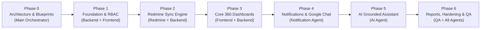

# PHASED IMPLEMENTATION ROADMAP & SPRINT PLAN
## Multi-Agent Delivery Blueprint for Company Intelligence Platform

---

## 1. Delivery Methodology & Agent Governance

This project is delivered across sequential phases. Each phase has explicit agent ownership, defined deliverables, and verification checkpoints before advancing.

---

## 2. Phase-by-Phase Roadmap

### PHASE 0: Repository Discovery & Architectural Blueprints (COMPLETED)
- **Primary Owner**: Main Orchestrator Agent
- **Deliverables**:
  - `docs/SYSTEM_ARCHITECTURE.md`: Complete topology, agent matrix, security boundaries.
  - `docs/DATABASE_DESIGN.md`: Relational schema, ERD, tables, indexes, audit logs.
  - `docs/REDMINE_DATA_MAPPING.md`: Discovery protocol, field mappings, watermark delta sync.
  - `docs/NOTIFICATION_RULES.md`: Severity tiers, escalation chains, Google Chat cards v2.
  - `docs/AI_AGENT_ARCHITECTURE.md`: OpenRouter gateway, deterministic tools, RBAC grounding.
  - `docs/API_DESIGN.md`: Modular REST API specs, envelopes, permission gates.
  - `docs/IMPLEMENTATION_PLAN.md`: Phase-by-phase roadmap and verification checkpoints.
- **Verification Gate**: Review and sign-off by Project Owner.

---

### PHASE 1: System Foundation, Database & Core RBAC
- **Primary Owners**: Backend Agent & Frontend Agent
- **Deliverables**:
  1. **Backend**:
     - FastAPI project bootstrap with modular settings (`pydantic-settings`).
     - SQLAlchemy 2.0 async engine and Alembic configuration.
     - Database models: `users`, `roles`, `employees`, `teams`, `audit_logs`.
     - Seed script for standard roles and initial Super Admin user.
     - JWT authentication endpoints (`/login`, `/refresh`, `/me`).
     - RBAC permission guards and dependency injectors.
  2. **Frontend**:
     - Next.js 14+ App Router project setup with TypeScript and Tailwind CSS.
     - App Shell layout: Collapsible Sidebar, Header, User Menu, Dark/Light Mode.
     - Authentication provider and route guards (`useAuth`).
     - Clean login screen with validation.
- **Verification Gate**: Super Admin logs in, receives valid JWT, and sees role-gated sidebar navigation; unauthorized requests return HTTP 401/403.

---

### PHASE 2: Redmine Integration & Data Synchronization Engine
- **Primary Owners**: Redmine Agent & Backend Agent
- **Deliverables**:
  1. Redmine REST API client using `httpx` with timeout and retry backoff.
  2. Discovery service: retrieves trackers, issue statuses, priorities, and custom fields.
  3. Incremental synchronization service with timestamp watermarks.
  4. Mappers for projects, issues (tasks), users (employees), and time entries.
  5. Sync state tracking table (`redmine_sync_state`) and sync logs.
  6. Admin API endpoints: `/api/v1/redmine/sync/trigger` and `/api/v1/redmine/status`.
  7. Offline snapshot cache support so UI operates seamlessly even if Redmine is temporarily unreachable.
- **Verification Gate**: Test sync against live or simulated Redmine payload; verify that tasks, projects, and users are correctly upserted into platform database without duplicates.

---

### PHASE 3: Core Role-Based Dashboards & Work Management
- **Primary Owners**: Frontend Agent & Backend Agent
- **Deliverables**:
  1. **Company Dashboard**:
     - Executive KPI cards: Active Projects, Delivery Velocity, Blocked Tasks, Overloaded Employees.
     - Recharts visual analytics: Project status breakdown donut, weekly time spent trend.
     - Company activity feed and high-priority management alert ticker.
  2. **Project Management Dashboard**:
     - Project list with health status pill (`ON_TRACK`, `AT_RISK`, `OFF_TRACK`).
     - Detailed Project 360 view: Milestones, contributors list, task burn-down chart, explainable risk reasons.
  3. **Team Management Dashboard**:
     - Team overview: Lead, headcount, active projects.
     - Member workload table with allocation progress bars.
  4. **Individual Employee Dashboard (Employee 360)**:
     - Profile details, current team memberships, active projects.
     - Assigned task list with overdue indicators.
     - Weekly capacity vs allocated hours gauge.
     - Historical contributions timeline and verified skills tags.
  5. **Task & Work Management**:
     - Searchable task board / table with filters for status, priority, tracker, and assignee.
     - Blocker flagging modal with reason capture.
- **Verification Gate**: Managers can navigate across projects and drill down into individual employee contributions; employees can only access authorized data.

---

### PHASE 4: Notification Engine & Google Chat Integration
- **Primary Owners**: Notification Agent & QA Agent
- **Deliverables**:
  1. Rule evaluation engine: evaluates task due dates, overdue states, blocked tasks, and workload overages.
  2. Escalation chain: warning -> urgent -> critical escalation after defined timeout.
  3. In-App Notification Center: slide-out drawer with unread count badge, filter by severity, mark-as-read.
  4. Google Chat integration service:
     - Configurable Google Chat space webhooks (`COMPANY_BROADCAST`, `PROJECT_ALERTS`, `LEADERSHIP_ESCALATION`).
     - Google Chat Cards v2 formatter with actionable links back to platform.
     - Test webhook dispatcher tool in Admin panel.
  5. Automated daily briefing generator (Employee, Team Lead, PM, Management).
- **Verification Gate**: Triggering an overdue task sends an in-app notification and dispatches a formatted Cards v2 payload to the configured Google Chat webhook space.

---

### PHASE 5: AI Company Assistant (OpenRouter Integration)
- **Primary Owners**: AI Agent & Backend Agent
- **Deliverables**:
  1. OpenRouter API integration via `httpx`/`openai` client with configurable model hierarchy.
  2. Deterministic backend tool registry (`get_projects_overview`, `get_employee_workload`, `search_historical_contributions`, `get_operational_blockers`).
  3. Strict RBAC grounding pipeline: all tool invocations run under the current user's security context.
  4. Frontend AI Assistant Drawer:
     - Natural language chat UI with streaming responses.
     - Source attribution pills (linking to project/task records).
     - Confidence and verification indicators.
  5. Conversation persistence and audit logging.
- **Verification Gate**: Asking *"Which projects are at risk?"* invokes `get_projects_overview`, returns verified project names with data citations, and never hallucinates fake records.

---

### PHASE 6: Reports, Analytics & Employee Growth
- **Primary Owners**: Backend Agent & Frontend Agent
- **Deliverables**:
  1. Executive summary generator (weekly/monthly PDF or CSV export).
  2. Employee skills matrix and professional development tracker.
  3. Team delivery velocity comparisons over time.
  4. Global omni-search modal (`Cmd+K` / `Ctrl+K`) across projects, tasks, employees, and teams.
- **Verification Gate**: Executive summary compiles live data and exports valid CSV/report files.

---

### PHASE 7: QA Validation, Security Auditing & Production Hardening
- **Primary Owners**: QA Agent & Main Orchestrator Agent
- **Deliverables**:
  1. Automated test suites:
     - Pytest for backend APIs, auth tokens, RBAC permissions, and sync logic.
     - Vitest / React Testing Library for frontend dashboard components.
  2. Security audit:
     - Verify zero secret exposure in client bundles.
     - SQL injection / parameterized query verification.
     - RBAC boundary testing (ensuring employees cannot access management endpoints).
  3. Performance optimization:
     - Database query profiling, indexing verification, frontend bundle optimization.
  4. Docker Compose deployment configuration for development and production.
  5. Comprehensive Administrator and Developer user guides.
- **Verification Gate**: All test suites pass with 100% core coverage; zero security boundary violations.

---

## 3. Agent Task Assignment Summary

| Agent | Phases Active | Primary Deliverables |
|---|---|---|
| **Main Orchestrator Agent** | Phase 0 - 7 | Architectural governance, task sequencing, code review, acceptance sign-off |
| **Backend Agent** | Phase 1, 2, 3, 5, 6 | FastAPI app, SQLAlchemy models, JWT auth, RBAC guards, REST endpoints |
| **Frontend Agent** | Phase 1, 3, 4, 5, 6 | Next.js App Router, Tailwind/shadcn UI, 360 Dashboards, AI drawer, charts |
| **Redmine Agent** | Phase 2 | Redmine client, discovery protocol, watermark sync, mapping tables |
| **Notification Agent** | Phase 4 | Notification rules engine, escalation dispatcher, Google Chat Cards v2 |
| **AI Agent** | Phase 5 | OpenRouter gateway, deterministic tool execution, source citation engine |
| **QA Agent** | Phase 4, 7 | Pytest suites, security boundary penetration tests, E2E validation |

