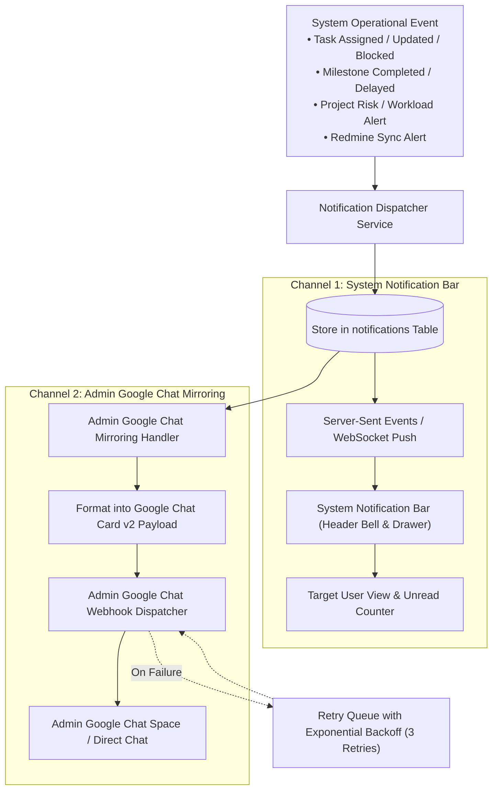
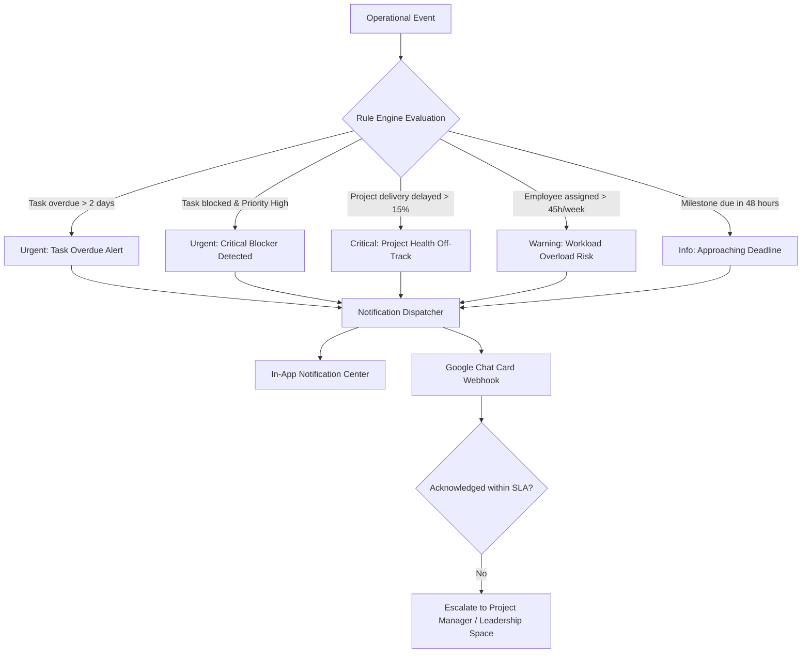

# NOTIFICATION & ESCALATION RULES SPECIFICATION
## Notification Agent: Rules Engine, Scheduling & Google Chat Integration

---

## 1. Overview & Core Mirroring Principle

The **Notification Agent** delivers real-time operational awareness across the organization. It processes system events, evaluates configurable threshold rules, manages escalation cascades, and powers both the in-app notification bar and external communication channels.

> [!IMPORTANT]
> **Admin Google Chat Mirroring Mandate:**
> Every single notification received in the **System Notification Bar** (in-app header bar, notification drawer, bell badge) **MUST simultaneously be mirrored and dispatched in real-time to the Administrator's Google Chat**. The Admin receives 100% parity with all system-level events directly in their Google Chat workspace without delay.

---

## 2. System Notification Bar & Admin Google Chat Mirroring Architecture



### 2.1 Mirroring Guarantees
1. **Zero Notification Loss**: When a notification is generated for the system notification bar, the transaction enqueues an immediate background dispatch task to the Admin's Google Chat webhook.
2. **Payload & Severity Parity**: The Admin's Google Chat message mirrors the exact severity (`INFO`, `WARNING`, `URGENT`, `CRITICAL`), title, full description, originating user/assignee, and provides a 1-click deep-link button opening that exact item in the system.
3. **Idempotency & Duplicate Prevention**: Each notification has a unique UUID `notification_id`. The delivery worker verifies delivery status to prevent double-posting to the Admin space.
4. **Offline Resilience**: If the Google Chat webhook is temporarily unreachable, the delivery attempt is registered with status `PENDING_RETRY` and retried up to 3 times with exponential backoff before flagging an administrative warning.

---

## 2. Notification Severity Tiers

| Severity | Color Code | In-App Behavior | Google Chat Space Destination | Escalation Threshold |
|---|---|---|---|---|
| **INFO** | Blue (`#3B82F6`) | Standard notification bell list | Optional team channel digest | None |
| **WARNING** | Amber (`#F59E0B`) | Unread badge indicator | Team / Project space | 48 hours without action |
| **URGENT** | Orange (`#F97316`) | Persistent toast + header alert | Project alerts & Team lead space | 24 hours without action |
| **CRITICAL** | Red (`#EF4444`) | Immediate modal / banner alert | Leadership escalation space | 4 hours without action |

---

## 3. Configurable Rule Triggers



### 3.1 Event Rules Specifications

1. **`TASK_OVERDUE`**:
   - Condition: `task.status != 'Closed'` AND `task.due_date < current_date()`.
   - Severity:
     - 1–2 days overdue: `WARNING` -> Assigned employee & Team lead.
     - 3+ days overdue: `URGENT` -> Project Manager & Team Lead space.
     - 7+ days overdue: `CRITICAL` -> Company Management escalation.

2. **`PROJECT_AT_RISK`**:
   - Condition: Projected completion exceeds `target_completion_date` by >10% OR >25% of tasks are blocked/overdue.
   - Severity: `CRITICAL`.
   - Targets: Project Manager, Team Lead, Leadership Google Chat space.

3. **`WORKLOAD_EXCEEDED`**:
   - Condition: Employee's sum of estimated task hours for current week exceeds `weekly_capacity_hours * 1.2` (e.g. > 48h).
   - Severity: `WARNING`.
   - Targets: Team Lead & Employee.

4. **`TASK_BLOCKED`**:
   - Condition: `is_blocked == True`.
   - Severity: `URGENT` if priority in (`High`, `Urgent`, `Immediate`), else `WARNING`.
   - Targets: Project Manager, Team Lead, and assignee.

---

## 4. Google Chat Integration Architecture

### 4.1 Space Topology

Google Chat webhook URLs are partitioned into designated organizational spaces:

1. **Admin System Mirror Space** (`ADMIN_SYSTEM_MIRROR`):
   - **Primary Admin Destination**: Receives an exact, real-time mirror of every notification that appears in the system notification bar.
   - Ensures the Administrator maintains 360-degree operational awareness from their mobile or desktop Google Chat client.
2. **Company Broadcast Space** (`COMPANY_BROADCAST`):
   - Executive announcements, company-wide milestones, monthly achievements.
3. **Project Alert Spaces** (`PROJECT_ALERTS`):
   - Mapped per project or project group. Receives blocker alerts, critical task updates, milestone completion notices.
4. **Team Spaces** (`TEAM_SPACE`):
   - Daily standup summaries, team task assignments, capacity warnings.
5. **Leadership Escalation Space** (`LEADERSHIP_ESCALATION`):
   - High-severity escalations, projects off-track, unresolved critical blockers (>24 hours).

### 4.2 Google Chat Card v2 Message Format

Alerts dispatched to Google Chat use modern **Cards v2** schema with clean formatting, status pills, and direct actionable links to the platform.

#### Example Admin Mirrored Notification Card (Dispatched on System-Bar Event)
```json
{
  "cardsV2": [
    {
      "cardId": "admin-mirror-notif-7890",
      "card": {
        "header": {
          "title": "[SYSTEM NOTIFICATION BAR MIRROR] Task Overdue",
          "subtitle": "Severity: URGENT | Category: Delivery Risk",
          "imageUrl": "https://img.icons8.com/color/48/alarm.png",
          "imageType": "CIRCLE"
        },
        "sections": [
          {
            "header": "Notification Summary",
            "widgets": [
              {
                "decoratedText": {
                  "topLabel": "Recipient: Lead Architect",
                  "text": "<b>Task #482 [API Auth Middleware] is 3 days overdue</b>",
                  "bottomLabel": "Project: Intelligent Projects Manager"
                }
              },
              {
                "decoratedText": {
                  "topLabel": "Event Timestamp",
                  "text": "2026-11-02 16:32:00 IST"
                }
              },
              {
                "buttonList": {
                  "buttons": [
                    {
                      "text": "Open in Platform",
                      "onClick": {
                        "openLink": {
                          "url": "https://company-intel.local/notifications"
                        }
                      }
                    },
                    {
                      "text": "View Task #482",
                      "onClick": {
                        "openLink": {
                          "url": "https://company-intel.local/tasks/482"
                        }
                      }
                    }
                  ]
                }
              }
            ]
          }
        ]
      }
    }
  ]
}
```

#### Example Card Payload (Project Alert / Blocker)
```json
{
  "cardsV2": [
    {
      "cardId": "alert-blocker-task-1042",
      "card": {
        "header": {
          "title": "URGENT: Task Blocker Detected",
          "subtitle": "Project: E-Commerce Mobile App (MOB-APP)",
          "imageUrl": "https://img.icons8.com/color/48/error--v1.png",
          "imageType": "CIRCLE"
        },
        "sections": [
          {
            "header": "Blocker Details",
            "widgets": [
              {
                "decoratedText": {
                  "topLabel": "Task #1042",
                  "text": "<b>Payment Gateway 3DS Auth Failure</b>",
                  "bottomLabel": "Assigned to: Sarah Connor (Senior Backend Dev)"
                }
              },
              {
                "decoratedText": {
                  "topLabel": "Reason for Blocker",
                  "text": "Awaiting sandbox API keys from payment partner bank.",
                  "wrapText": true
                }
              },
              {
                "buttonList": {
                  "buttons": [
                    {
                      "text": "View in Intelligence Platform",
                      "onClick": {
                        "openLink": {
                          "url": "https://company-intel.local/tasks/task-1042"
                        }
                      }
                    }
                  ]
                }
              }
            ]
          }
        ]
      }
    }
  ]
}
```

---

## 5. Daily Briefings Engine

The Notification Agent runs automated daily briefing generators scheduled at 08:30 AM local time:

1. **Employee Daily Briefing**:
   - Today's prioritized tasks, upcoming deadlines (next 48h), unread mentions.
2. **Team Lead Briefing**:
   - Team member workload distribution, blocked tasks requiring unblocking, tasks nearing deadline.
3. **Project Manager Briefing**:
   - Milestone burn-down status, blocked items count, over-budget task hours.
4. **Management Briefing**:
   - High-level KPIs: Active projects, projects at risk, cross-team operational velocity.

