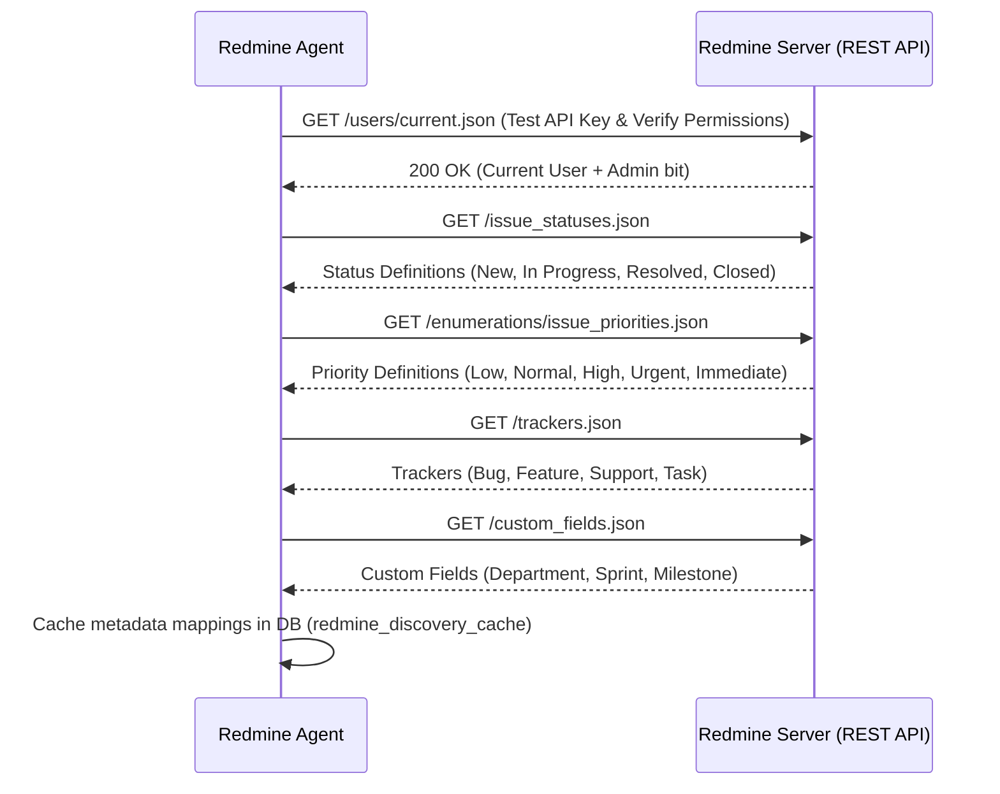

# REDMINE INTEGRATION & DATA MAPPING SPECIFICATION
## Redmine Agent: API Discovery, Sync Strategy & Data Mapping

---

## 1. Overview & Objectives

The **Redmine Agent** is responsible for establishing a resilient, performant bridge between the external Redmine instance and the Company Intelligence Platform.

Key objectives:
1. Automatically discover Redmine schemas (projects, trackers, custom fields, issue statuses, priorities).
2. Execute an initial full backfill without overwhelming the Redmine server.
3. Maintain continuous near-real-time state using an incremental delta sync (watermark-based).
4. Map external numerical IDs to platform UUIDs while strictly preserving data integrity.
5. Provide a deterministic cache and fallback mode when Redmine is temporarily unavailable.

---

## 2. Redmine API Discovery Protocol

Before syncing records, the Redmine Agent initiates the discovery handshake:



---

## 3. Entity Data Mapping Matrix

### 3.1 Project Mapping
| Redmine Project Field | Platform `projects` Field | Transform / Rules |
|---|---|---|
| `id` (int) | mapped via `redmine_mappings` | Redmine ID mapped to internal UUID |
| `name` (string) | `name` | Direct string |
| `identifier` (string) | `code` | Converted to uppercase (e.g., `proj-core` -> `PROJ-CORE`) |
| `description` (string) | `description` | Markdown / Textile converted to clean text |
| `status` (int: 1=active, 5=closed, 9=archived) | `status` | 1 -> `ACTIVE`, 5 -> `COMPLETED`, 9 -> `ON_HOLD` |
| `created_on` (ISO) | `created_at` | Direct timestamptz |
| `updated_on` (ISO) | `updated_at` | Direct timestamptz |

### 3.2 User / Employee Mapping
| Redmine User Field | Platform `employees` Field | Transform / Rules |
|---|---|---|
| `id` (int) | mapped via `redmine_mappings` | Redmine ID mapped to internal UUID |
| `login` (string) | `employee_number` / fallback | Sanitized username |
| `firstname` (string) | `first_name` | Direct string |
| `lastname` (string) | `last_name` | Direct string |
| `mail` (string) | `email` | Lowercased, indexed unique identifier |
| `status` (int: 1=active, 3=locked) | `status` | 1 -> `ACTIVE`, 3 -> `DEPARTED` |

*Note: If an employee record already exists with matching email, link the existing record instead of duplicating.*

### 3.3 Issue / Task Mapping
| Redmine Issue Field | Platform `tasks` Field | Transform / Rules |
|---|---|---|
| `id` (int) | mapped via `redmine_mappings` | Redmine ID mapped to internal UUID |
| `project.id` (int) | `project_id` | Resolved via project mapping table |
| `assigned_to.id` (int) | `assigned_to_id` | Resolved via employee mapping table |
| `author.id` (int) | `author_id` | Resolved via employee mapping table |
| `subject` (string) | `title` | Max 255 chars |
| `description` (string) | `description` | Text |
| `tracker.name` (string) | `tracker` | e.g. "Bug", "Feature" |
| `status.name` (string) | `status` | Normalized to standard status set |
| `priority.name` (string) | `priority` | Normalized to Low, Normal, High, Urgent |
| `done_ratio` (int 0-100) | `progress_percentage` | Direct integer |
| `estimated_hours` (float) | `estimated_hours` | Decimal, default 0.0 |
| `spent_hours` (float) | `spent_hours` | Decimal, default 0.0 |
| `start_date` (date) | `start_date` | YYYY-MM-DD |
| `due_date` (date) | `due_date` | YYYY-MM-DD. Auto-evaluates `is_overdue = (due_date < TODAY && status != 'Closed')` |
| Custom Field "Blocker" | `is_blocked`, `blocker_reason` | If custom field contains text or status is 'Blocked' |

### 3.4 Time Entries Mapping
| Redmine Time Entry Field | Platform `time_entries` Field | Transform / Rules |
|---|---|---|
| `id` (int) | mapped via `redmine_mappings` | Internal UUID |
| `issue.id` (int) | `task_id` | Resolved via task mapping table |
| `project.id` (int) | `project_id` | Resolved via project mapping table |
| `user.id` (int) | `employee_id` | Resolved via employee mapping table |
| `hours` (float) | `hours` | Decimal hours |
| `spent_on` (date) | `spent_on` | YYYY-MM-DD |
| `activity.name` (string) | `activity_type` | e.g. Development, QA, Design, Management |
| `comments` (string) | `comments` | Text description |

### 3.5 Versions & Milestones Mapping (MCP Market & Redmine CLI Reference)
| Redmine Version Field | Platform `project_milestones` Field | Transform / Rules |
|---|---|---|
| `id` (int) | mapped via `redmine_mappings` | Internal UUID |
| `project.id` (int) | `project_id` | Resolved via project mapping table |
| `name` (string) | `title` | Milestone title (e.g. "Release 1.2.0") |
| `description` (string) | `description` | Text |
| `status` (string) | `status` | Normalized (`open`, `locked`, `closed`) |
| `due_date` (date) | `due_date` | YYYY-MM-DD |
| `sharing` (string) | `sharing_scope` | `none`, `descendants`, `tree`, etc. |

### 3.6 Journals & Change History Mapping
| Redmine Journal Field | Platform `task_journals` Field | Transform / Rules |
|---|---|---|
| `id` (int) | mapped via `redmine_mappings` | Internal UUID |
| `issue_id` (int) | `task_id` | Resolved via task mapping table |
| `user.id` (int) | `author_id` | Resolved via employee mapping table |
| `notes` (string) | `notes` | Change comment or reasoning |
| `details` (list) | `changes` (JSONB) | Captures field, old_value, new_value (e.g. status changed from "In Progress" to "Blocked") |
| `created_on` (ISO) | `created_at` | Timestamptz |

---

## 4. Synchronization Architecture

### 4.1 Incremental Sync Loop (Watermark Strategy)

```mermaid
flowchart TD
    START([Sync Trigger: Cron / Manual]) --> READ_WATERMARK[Read last_sync_timestamp from redmine_sync_state]
    READ_WATERMARK --> FETCH_ISSUES["Fetch Redmine Issues: updated_on >= {watermark}"]
    FETCH_ISSUES --> BATCH_CHECK{Any issues returned?}
    
    BATCH_CHECK -- Yes --> UPSERT_ISSUES[Upsert Tasks into Platform DB]
    UPSERT_ISSUES --> UPDATE_MAPPINGS[Record Redmine ID <-> Platform UUID in redmine_mappings]
    UPDATE_MAPPINGS --> CALC_HEALTH[Recalculate Project Health & Overdue Flags]
    CALC_HEALTH --> NEXT_PAGE{Has more pages?}
    
    NEXT_PAGE -- Yes --> FETCH_NEXT_PAGE[Fetch next page with limit=100 & offset]
    FETCH_NEXT_PAGE --> UPSERT_ISSUES
    
    NEXT_PAGE -- No --> COMMIT_WATERMARK[Update last_sync_timestamp = NOW()]
    BATCH_CHECK -- No --> COMMIT_WATERMARK
    COMMIT_WATERMARK --> LOG_SUCCESS[Record Sync Log in DB]
    LOG_SUCCESS --> END([Done])
```

### 4.2 Rate Limiting & Resilience
1. **Concurrency Cap**: Maximum of 3 concurrent HTTP calls to Redmine.
2. **Page Limit**: `limit=100` per request to minimize server load.
3. **Exponential Backoff**: If Redmine responds with HTTP 429 or 503, retry with backoff factor (1s, 2s, 4s, 8s, max 30s).
4. **Cache & Read Resilience**: In the event of network disruption or Redmine server downtime, the platform gracefully serves cached database records with an alert banner: *"Displaying synchronized snapshot from [last_sync_timestamp]"*.

### 4.3 Write Operations Policy
Per Section 25, rule 14:
- The platform is primarily a read-and-intelligence consumer.
- Any write-back to Redmine (e.g. updating a task status or logging a comment) is an explicitly gated operation requiring explicit user confirmation and role permissions.
- AI assistant is strictly prohibited from mutating Redmine data directly.

