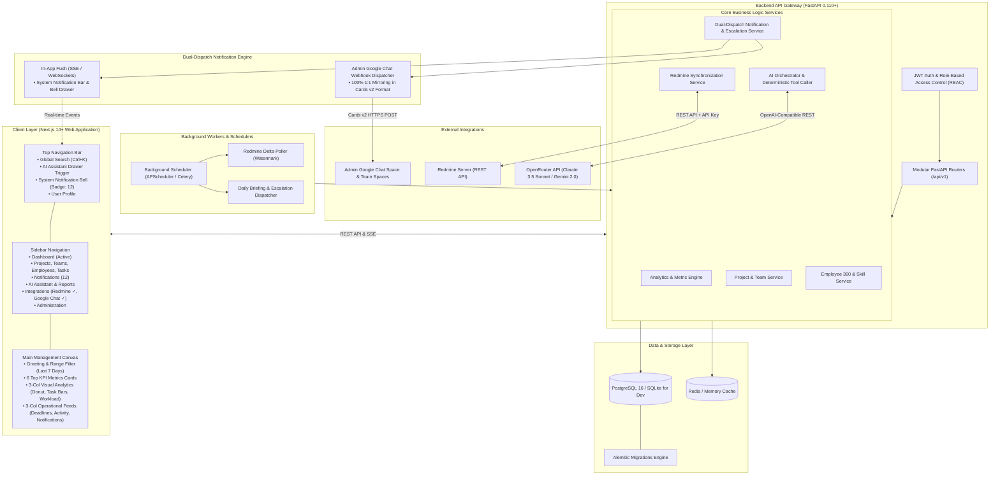
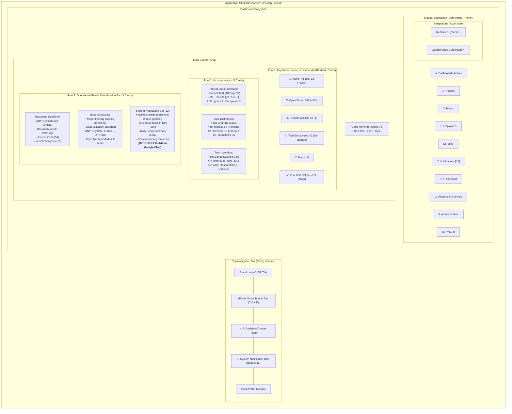
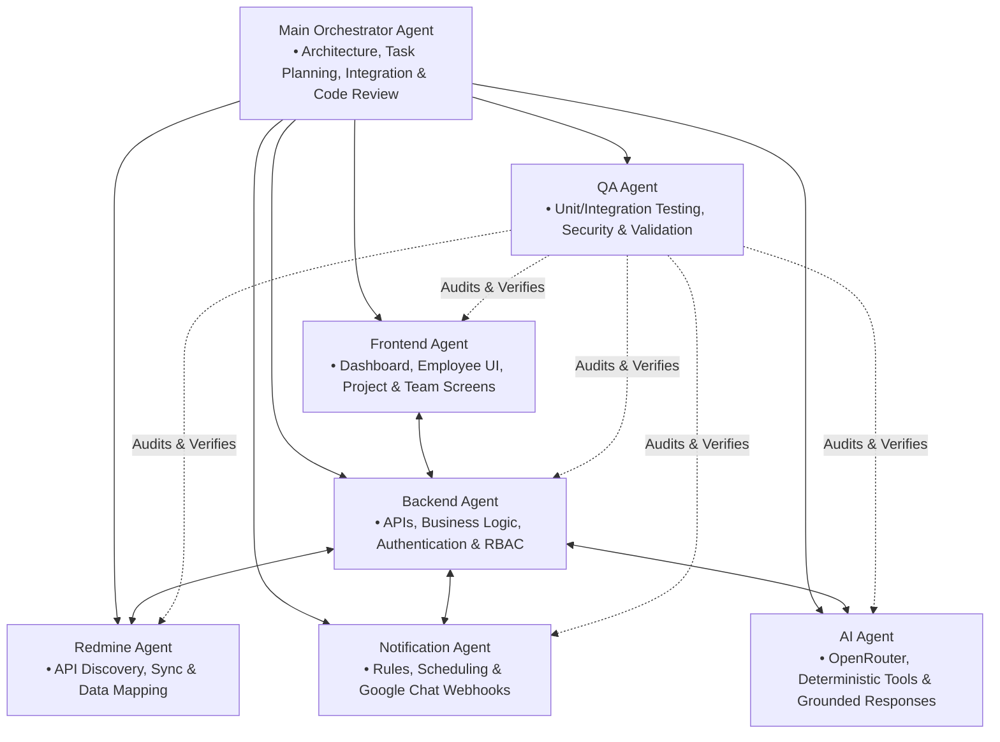
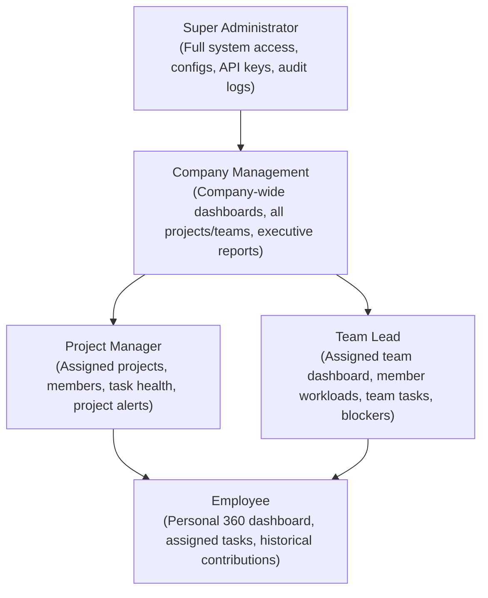
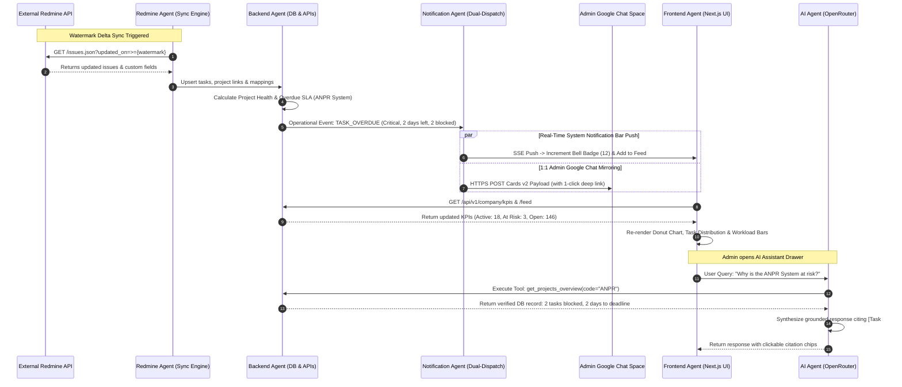
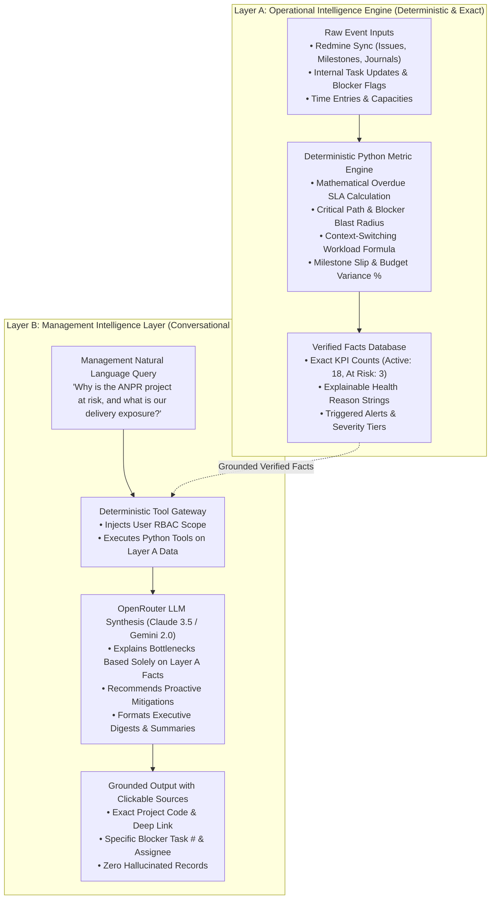

# SYSTEM ARCHITECTURE SPECIFICATION
## Company Intelligence Platform: Enterprise Project, Team, Employee & AI-Powered Management System

---

## 1. Executive Summary & Topology

The **Company Intelligence Platform** is a centralized operational intelligence web platform designed to give leadership, project managers, team leads, and employees real-time visibility into project health, team velocity, individual workloads, and historical contributions. It unifies project tracking from external sources (such as Redmine) with an internal notification engine, Google Chat broadcast spaces, and an AI-powered conversational intelligence layer powered by OpenRouter.

### 1.1 High-Level Architecture Topology



---

## 2. Dashboard UI Layout Architecture (Reference Visual Design)

The primary management dashboard implements the professional enterprise layout structured below:



---

## 2. Multi-Agent Development & Organizational Model

To develop, verify, and maintain this enterprise platform, work is partitioned across **7 specialized engineering agents** governed by a **Main Orchestrator Agent**:



### Agent Roles & Boundaries Matrix

| Agent | Core Responsibilities | Input Artifacts | Output Deliverables |
|---|---|---|---|
| **Main Orchestrator Agent** | Architecture governance, cross-module schema alignment, task planning, pull request review, progress tracking. | Master System Prompt, User Requirements | Architecture Specs, System Models, Sprint Roadmaps, Code Review approvals. |
| **Frontend Agent** | Building responsive, role-tailored dashboards (Company, Project, Team, Employee 360), reusable components, UI state management, Recharts analytics. | UI/UX Design System, API contracts | Next.js components, page routes, state hooks, chart visualizations. |
| **Backend Agent** | FastAPI endpoints, SQLAlchemy async models, database migrations, authentication, RBAC enforcement, query optimization. | API Design, Database Design, RBAC Matrix | FastAPI routes, schemas, database models, auth middleware. |
| **Redmine Agent** | Redmine REST API client, schema discovery, delta synchronizer, entity mappers (projects, issues, time entries, custom fields), resilience/rate limiting. | Redmine Data Mapping spec, Redmine API docs | Sync engine, mapping algorithms, synchronization logs, health status. |
| **Notification Agent** | Event dispatching, severity tagging, rule evaluation, escalation queues, user preference filters, Google Chat webhook card formatting. | Notification Rules spec, Google Chat card layout | Notification dispatcher, background scheduler, Google Chat client, daily briefings. |
| **AI Agent** | OpenRouter integration, tool-use framework (deterministic SQL/metric tools), role-aware query filtering, grounded responses with evidence citations. | AI Architecture spec, DB schemas | AI Chat service, tool execution handlers, context builders, token/audit tracking. |
| **QA Agent** | Test automation (pytest for backend, Vitest/Playwright for frontend), security auditing (RBAC penetration, SQL injection, token leaks), performance benchmarking. | Acceptance Criteria, Test Scenarios | Test suites, security scan reports, load test scripts, CI pipelines. |

---

## 3. Technology Stack Specification

### 3.1 Frontend Stack
- **Framework**: Next.js 14+ (App Router)
- **Language**: TypeScript 5.x (strict type checking enabled)
- **Styling**: Tailwind CSS with enterprise color palettes (slate/indigo/neutral themes)
- **Component Primitives**: Radix UI / shadcn/ui (Accessible, headless, customizable)
- **Icons**: Lucide React
- **Data Visualization**: Recharts (Burn-down charts, team velocity, project status donuts, workload bars)
- **State Management**: TanStack Query (React Query) for server state caching + Zustand for lightweight local UI state
- **HTTP Client**: Axios / Fetch with automatic auth token refresh

### 3.2 Backend Stack
- **Framework**: FastAPI (Python 3.11+)
- **Async Runtime**: AnyIO / Uvicorn
- **ORM & Migrations**: SQLAlchemy 2.0 (asyncio syntax) + Alembic for migrations
- **Data Validation & Serialisation**: Pydantic v2 (Strict typing, JSON schema generation)
- **Authentication**: OAuth2 Password Flow + PyJWT (Access Tokens & Refresh Tokens)
- **Password Hashing**: Passlib with bcrypt / Argon2
- **Database Engine**: PostgreSQL 16 (production) / SQLite via aiosqlite (local development & unit testing)
- **Task Scheduling & Worker**: APScheduler 3.x / Celery with Redis for asynchronous background tasks

### 3.3 Integrations & Third-Party APIs
- **Redmine API**: `python-redmine` and `httpx` async HTTP client with exponential backoff
- **Google Chat**: HTTPS Webhook client with Google Chat Card v2 format
- **AI Gateway**: OpenRouter API (`https://openrouter.ai/api/v1`) using `httpx` or `openai` SDK pointing to custom base URL, supporting models such as `anthropic/claude-3.5-sonnet`, `openai/gpt-4o`, `google/gemini-2.0-flash`.

---

## 4. Security & Role-Based Access Control (RBAC) Architecture

The platform enforces strict role boundaries across all API endpoints and frontend views.

### 4.1 Role Hierarchy & Permissions



### 4.2 Security Principles
1. **Zero Secret Leaks**: API tokens for Redmine, Google Chat webhooks, and OpenRouter keys are stored in encrypted environment variables or database settings tables with restricted Super Admin access. They are never sent to the client.
2. **Deterministic Data Scoping**: Every API request extracts `current_user` from the JWT token. Query scopes are computed server-side:
   - An employee querying `/api/v1/tasks` only gets tasks assigned to them.
   - A team lead querying `/api/v1/teams/{id}/workload` must be assigned as lead to `{id}` or have `Company Management`/`Super Admin` role.
3. **Audit Logging**: Any administrative changes (role modification, integration key update, sync trigger, manual escalation) write an immutable record to the `audit_logs` table.
4. **AI Output Grounding**: The AI assistant never executes raw user SQL. It invokes pre-authorized Python tools that inherit the caller's RBAC scope.

---

## 5. Repository Directory Layout

```
intelligent_projects_manager/
│
├── docs/                               # Architectural & Technical Blueprint
│   ├── SYSTEM_ARCHITECTURE.md          # Topology, agents, and security
│   ├── DATABASE_DESIGN.md              # Relational models, ERD, indexing
│   ├── API_DESIGN.md                   # OpenAPI router tree & endpoints
│   ├── REDMINE_DATA_MAPPING.md         # Redmine sync protocol & mappings
│   ├── NOTIFICATION_RULES.md           # Alert tiers, escalation, Google Chat
│   ├── AI_AGENT_ARCHITECTURE.md        # OpenRouter tool-use & grounding
│   └── IMPLEMENTATION_PLAN.md          # Phased sprint delivery roadmap
│
├── backend/                            # FastAPI Application
│   ├── app/
│   │   ├── api/                        # API route controllers
│   │   │   ├── v1/
│   │   │   │   ├── auth.py             # Login, token refresh, current user
│   │   │   │   ├── company.py          # Executive KPIs, company activity
│   │   │   │   ├── projects.py         # Project health, milestones, members
│   │   │   │   ├── teams.py            # Team velocity, workload, members
│   │   │   │   ├── employees.py        # Employee 360, skills, history
│   │   │   │   ├── tasks.py            # Tasks, blockers, deadlines
│   │   │   │   ├── notifications.py    # Notification center & preferences
│   │   │   │   ├── redmine.py          # Redmine sync triggers & status
│   │   │   │   ├── ai.py               # Conversational AI & tool queries
│   │   │   │   ├── reports.py          # Exportable reports & analytics
│   │   │   │   └── admin.py            # RBAC management & integrations
│   │   │   └── router.py               # Combined API v1 router
│   │   ├── core/                       # Core infrastructure
│   │   │   ├── config.py               # Pydantic Settings & env vars
│   │   │   ├── database.py             # SQLAlchemy async engine & session
│   │   │   ├── security.py             # Password hashing, JWT utils
│   │   │   └── permissions.py          # RBAC dependency guards
│   │   ├── models/                     # SQLAlchemy 2.0 ORM models
│   │   │   ├── user.py                 # Users, Roles, Permissions
│   │   │   ├── employee.py             # Employee profile, skills, history
│   │   │   ├── team.py                 # Teams, team memberships
│   │   │   ├── project.py              # Projects, milestones, contributors
│   │   │   ├── task.py                 # Tasks, time entries, blockers
│   │   │   ├── notification.py         # Notifications, rules, delivery
│   │   │   ├── redmine_sync.py         # Redmine mapping & sync logs
│   │   │   └── audit.py                # System audit logs
│   │   ├── schemas/                    # Pydantic v2 validation models
│   │   ├── services/                   # Business logic layer
│   │   │   ├── redmine_service.py      # Redmine client & delta synchronizer
│   │   │   ├── notification_service.py # Event dispatcher & escalation engine
│   │   │   ├── google_chat_service.py  # Webhook & card formatter
│   │   │   ├── ai_service.py           # OpenRouter client & tool executors
│   │   │   └── analytics_service.py    # Metric & KPI aggregations
│   │   └── workers/                    # Background scheduler tasks
│   │       ├── scheduler.py            # Periodic jobs (sync, briefings)
│   │       └── sync_worker.py          # Redmine polling worker
│   ├── alembic/                        # Database migration scripts
│   ├── tests/                          # Backend test suite (pytest)
│   ├── requirements.txt                # Python dependencies
│   └── main.py                         # Application entrypoint
│
├── frontend/                           # Next.js 14+ Application
│   ├── src/
│   │   ├── app/                        # App Router directory
│   │   │   ├── (auth)/login/           # Login screen
│   │   │   ├── (dashboard)/
│   │   │   │   ├── layout.tsx          # App shell (Sidebar, Header, Search)
│   │   │   │   ├── page.tsx            # Company Dashboard
│   │   │   │   ├── projects/           # Projects list & Project detail
│   │   │   │   ├── teams/              # Teams list & Team detail
│   │   │   │   ├── employees/          # Employee directory & 360 profile
│   │   │   │   ├── tasks/              # Task board / list / blockers
│   │   │   │   ├── notifications/      # Notification Center & History
│   │   │   │   ├── reports/            # Reports generator & export
│   │   │   │   └── admin/              # User, team, and integration admin
│   │   ├── components/                 # Reusable UI widgets
│   │   │   ├── ui/                     # Button, Dialog, Dropdown, Input, etc.
│   │   │   ├── layout/                 # Sidebar, TopNav, GlobalSearch
│   │   │   ├── cards/                  # KPICard, HealthBadge, RiskBadge
│   │   │   ├── charts/                 # BurnDownChart, WorkloadChart, Donut
│   │   │   ├── ai/                     # AssistantDrawer, GroundedResponseCard
│   │   │   └── notifications/          # NotificationBell, BriefingModal
│   │   ├── lib/                        # Client utilities, API client, auth
│   │   ├── types/                      # TypeScript definitions
│   │   └── hooks/                      # Custom React hooks (useAuth, useTasks)
│   ├── package.json
│   ├── tsconfig.json
│   └── tailwind.config.ts
│
├── plan.md                             # Master System Prompt & Requirements
└── README.md                           # Quickstart & Repository Overview
```


---

## 6. End-to-End Operational Sequence (7-Agent Interaction)

The following sequence visualizes how the 7 specialized agents cooperate during a live operational cycle:




---

## 7. The Dual-Intelligence Architecture (Operational vs. Management Intelligence)

To guarantee absolute trust, transparency, and eliminate AI hallucinations, the platform strictly bifurcates intelligence into two distinct, decoupled layers:



### Architectural Safeguards
1. **Never Calculate in Prose**: Numbers, percentages, project health statuses, and overdue days are never computed by the LLM prompt. They are computed by Python code in Layer A and passed as verified arguments to Layer B.
2. **Explainable Health Grounding**: Every health badge in the UI (e.g. `AT_RISK`) is accompanied by the exact deterministic string generated by Layer A (e.g. *"2 critical path tasks overdue by 4 days, impacting Milestone Release 1.2.0"*).
3. **Audited Insights**: Every AI explanation generated in Layer B is stored in `ai_messages` alongside the exact tool output snapshot that grounded it.
